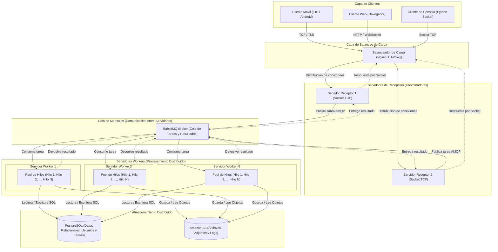
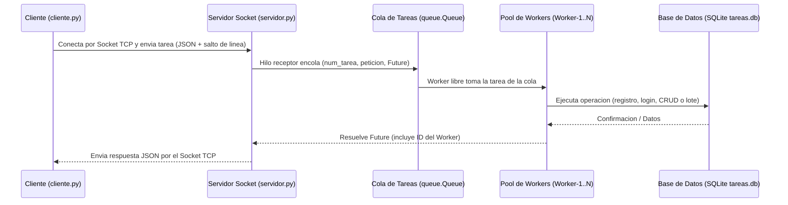

# Sistema de Gestión de Tareas — Rediseño como Sistema Distribuido (Sockets y Pool de Workers)

- **Alumno:** Reguera, Luciano Oscar
- **Materia:** Programación sobre Redes
- **Comisión:** D
- **Trabajo:** PFO 3 — Rediseño como Sistema Distribuido (Cliente-Servidor)

Rediseño del Sistema de Gestión de Tareas (originalmente una API REST monolítica en el PFO 2) hacia una **arquitectura distribuida cliente-servidor utilizando sockets TCP**. El servidor recibe tareas de múltiples clientes en simultáneo, las encola en una cola de mensajes segura para hilos (`queue.Queue`) y las distribuye entre un **pool de hilos workers** (`Worker-1`..`Worker-N`) que procesan las operaciones y persisten los datos en `tareas.db`.

---

## Índice

1. [Diseño de la Arquitectura Distribuida (Consigna 1)](#1-diseño-de-la-arquitectura-distribuida-consigna-1)
2. [Implementación en Python con Sockets y Workers (Consigna 2)](#2-implementación-en-python-con-sockets-y-workers-consigna-2)
3. [Estructura del proyecto](#3-estructura-del-proyecto)
4. [Requisitos e instalación](#4-requisitos-e-instalación)
5. [Ejecución y uso](#5-ejecución-y-uso)
6. [Protocolo de comunicación por Socket TCP](#6-protocolo-de-comunicación-por-socket-tcp)
7. [Pruebas rápidas desde terminal](#7-pruebas-rápidas-desde-terminal)

---

## 1. Diseño de la Arquitectura Distribuida (Consigna 1)

### 1.1. Diagrama General del Sistema Distribuido



### 1.2. Descripción de los Componentes de la Arquitectura

1. **Clientes (Móviles, Web y Consola):**
   - Representan los puntos de entrada de los usuarios finales (aplicaciones móviles iOS/Android, navegadores web y el cliente de consola en Python).
   - Envían tareas y solicitudes de gestión de tareas sin necesidad de conocer qué nodo interno las procesará.

2. **Balanceador de Carga (Nginx / HAProxy):**
   - Actúa como punto único de entrada (*reverse proxy* L4/L7) frente a los clientes.
   - Reparte las conexiones entrantes entre los distintos servidores de recepción mediante algoritmos como *Round Robin* o *Least Connections*, evitando sobrecargas y realizando chequeos de salud (*health checks*) para tolerar caídas de nodos.

3. **Cola de Mensajes (RabbitMQ) para comunicación entre servidores:**
   - Desacopla a los servidores que reciben las conexiones TCP de los servidores encargados de ejecutar las tareas.
   - Los servidores receptores publican cada tarea como un mensaje en RabbitMQ (protocolo AMQP) y los servidores *workers* las consumen a su propio ritmo, absorbiendo picos de tráfico y garantizando que ninguna tarea se pierda si un *worker* se reinicia.

4. **Servidores Workers (cada uno con su Pool de Hilos):**
   - Son nodos dedicados al procesamiento de las tareas consumidas desde RabbitMQ.
   - Cada servidor *worker* mantiene un **pool de hilos** (*thread pool*) interno que permite ejecutar múltiples tareas en paralelo aprovechando la concurrencia en operaciones de entrada/salida (consultas a base de datos y almacenamiento en red) sin el costo de crear y destruir hilos por cada petición.

5. **Almacenamiento Distribuido (PostgreSQL y Amazon S3):**
   - **PostgreSQL:** Motor relacional cliente-servidor (con nodo primario para escrituras y réplicas de lectura) donde todos los *workers* consultan y actualizan de forma consistente los datos estructurados: cuentas de usuario, hashes de contraseñas y estado de las tareas.
   - **Amazon S3 (Object Storage):** Almacenamiento distribuido de objetos de alta durabilidad para archivos adjuntos asociados a las tareas, reportes generados, respaldos y registros (*logs*) de ejecución.

---

## 2. Implementación en Python con Sockets y Workers (Consigna 2)

En la implementación práctica (`servidor.py` y `cliente.py`) se lleva este modelo al entorno local de Python:

- **Comunicación por Sockets TCP:** `cliente.py` y `servidor.py` se comunican directamente sobre sockets TCP (`socket.AF_INET`, `socket.SOCK_STREAM`) intercambiando mensajes JSON delimitados por salto de línea (`\n`).
- **Hilos Receptores por Cliente:** El servidor acepta múltiples clientes en simultáneo asignando un hilo receptor a cada conexión entrante.
- **Cola de Mensajes (`queue.Queue`):** Cumple el rol del *broker* de mensajería (RabbitMQ), desacoplando la recepción por socket de la ejecución de las tareas.
- **Pool de Hilos Workers (`Worker-1` a `Worker-N`):** Al iniciar `servidor.py`, se levanta un pool fijo de hilos *workers* que toman tareas de la cola, ejecutan la operación sobre la base de datos de forma segura (*thread-safe* mediante `threading.Lock`) y devuelven el resultado junto con el nombre del *worker* que la procesó.

### Diagrama de Secuencia de la Implementación



---

## 3. Estructura del proyecto

```text
PFO3/
├── servidor.py        # Servidor TCP con cola de mensajes y pool de hilos workers
├── cliente.py         # Cliente de consola por socket TCP (individual y por lotes)
├── requirements.txt   # Dependencias opcionales (funciona con biblioteca estándar)
├── capturas/          # Capturas de pantalla
├── README.md          # Documentación y diagramas de arquitectura
└── tareas.db          # Base de datos SQLite (se genera automáticamente al ejecutar)
```

---

## 4. Requisitos e instalación

- **Python 3.10 o superior**.
- El sistema utiliza módulos de la **biblioteca estándar de Python** (`socket`, `threading`, `queue`, `concurrent.futures`, `sqlite3`, `json`, `hashlib`, `secrets`, `hmac`), por lo que puede ejecutarse directamente sin instalar paquetes externos.
- Opcionalmente, si se instala `Werkzeug` (`pip install -r requirements.txt`), el servidor lo utiliza para generar y verificar los hashes `scrypt`; de lo contrario, usa su implementación nativa equivalente con `hashlib.scrypt`.

```bash
git clone <URL-del-repositorio>
cd PFO3
```

---

## 5. Ejecución y uso

Se necesitan **dos terminales** (o más, si se desea conectar varios clientes a la vez).

### Terminal 1 — Servidor con Pool de Workers

```bash
python servidor.py
```

Opcionalmente se puede especificar el puerto y la cantidad de hilos *workers* en el pool (por defecto puerto `5000` y `4` workers):

```bash
python servidor.py 5000 4
```

Salida al iniciar:

```text
[DB] Base de datos 'tareas.db' lista.
[WORKERS] Pool de 4 workers activos (Worker-1, Worker-2, Worker-3, Worker-4).
[SOCKET] Servidor escuchando en localhost:5000...
```

### Terminal 2 — Cliente por Socket TCP

```bash
python cliente.py
```

Opcionalmente se puede indicar otro host y puerto:

```bash
python cliente.py localhost:5000
```

### Menús del cliente

```text
===== Menú principal =====        ===== Tareas (usuario) =====
1. Registrarse                    1. Ver mis tareas
2. Iniciar sesión                 2. Nueva tarea
0. Salir                          3. Marcar completada / pendiente
                                  4. Editar tarea
                                  5. Eliminar tarea
                                  6. Enviar lote de tareas (prueba de Workers)
                                  7. Cerrar sesión
                                  0. Salir
```

- **Identificación del Worker:** En cada operación el cliente informa qué hilo *worker* del servidor procesó la tarea (por ejemplo: `✅ Tarea #1 creada (procesada por Worker-2).`).
- **Opción 6 — Enviar lote de tareas (prueba de Workers):** Permite enviar entre 1 y 20 tareas en paralelo abriendo conexiones concurrentes por socket. Tanto en el cliente como en la consola del servidor se observa cómo la cola distribuye las tareas entre `Worker-1`, `Worker-2`, `Worker-3` y `Worker-4` en simultáneo.
- **Cancelación segura:** En cualquier operación se puede presionar **Ctrl+C** para cancelar y volver al menú sin efectuar cambios.

---

## 6. Protocolo de comunicación por Socket TCP

El cliente y el servidor se comunican enviando objetos **JSON en una sola línea terminada en `\n`** (codificados en `UTF-8`).

### Acciones disponibles

| Acción (`accion`) | Requiere `auth` | Descripción |
|---|---|---|
| `registro` | No | Registra un usuario nuevo con contraseña hasheada (`scrypt`) |
| `login` | No | Verifica las credenciales de un usuario |
| `listar_tareas` | Sí | Devuelve todas las tareas del usuario autenticado |
| `crear_tarea` | Sí | Crea una nueva tarea y la asigna al usuario |
| `actualizar_tarea` | Sí | Modifica `titulo`, `descripcion` o `completada` de una tarea |
| `eliminar_tarea` | Sí | Elimina una tarea perteneciente al usuario |

### Ejemplo de Petición (Cliente → Servidor)

```json
{"accion": "crear_tarea", "auth": {"usuario": "ana", "contraseña": "1234"}, "datos": {"titulo": "Configurar RabbitMQ", "descripcion": "Definir cola de tareas"}}
```

### Ejemplo de Respuesta (Servidor → Cliente)

```json
{
  "ok": true,
  "codigo": 201,
  "worker": "Worker-2",
  "datos": {
    "id": 1,
    "titulo": "Configurar RabbitMQ",
    "descripcion": "Definir cola de tareas",
    "completada": false,
    "creada_en": "2026-10-30 12:30:00"
  }
}
```

---

## 7. Pruebas rápidas desde terminal

Con `python servidor.py` en ejecución, se puede probar el envío concurrente de tareas por socket directamente con este comando de una línea en otra terminal:

```bash
python -c "from cliente import llamar_servidor; print(llamar_servidor('registro', {'usuario': 'ana', 'contraseña': '1234'})); [print(llamar_servidor('crear_tarea', {'titulo': f'Tarea {i}'}, ('ana', '1234'))) for i in range(1, 5)]"
```
